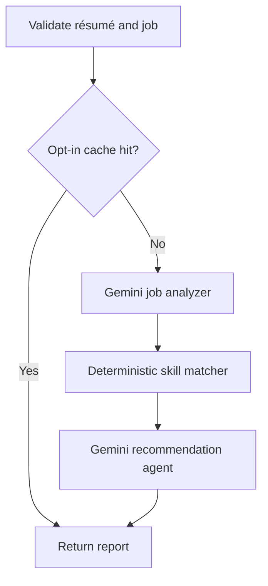

# CareerPilot AI

[](https://github.com/pranithbitla/Agentic-AI/actions/workflows/careerpilot-tests.yml)


CareerPilot AI is an explainable résumé-to-job matching application. It uses Gemini to turn an
unstructured job description into validated data, calculates skill coverage with deterministic
Python logic, and uses a LangGraph workflow to generate grounded recommendations.

> Match percentages represent detected skill coverage. They are not hiring probabilities.

## 30-second project review

| Area | Implementation | Evidence |
|---|---|---|
| Agent orchestration | Explicit LangGraph state, nodes, edges, and conditional cache route | [`careerpilot/graph.py`](careerpilot/graph.py) |
| Structured AI output | Gemini responses validated with Pydantic schemas | [`job_analyzer.py`](careerpilot/job_analyzer.py) |
| Explainable scoring | Required/preferred weighting and two-way alias normalization | [`skill_matcher.py`](careerpilot/skill_matcher.py) |
| AI safety | User text is JSON-encoded as untrusted data; prompts prohibit following embedded instructions | [`prompts.py`](careerpilot/prompts.py) |
| Privacy | Temporary uploads are deleted; persistent disk caching is disabled by default | [`cache.py`](careerpilot/cache.py) |
| Quality | Ruff plus pytest coverage on Python 3.11 and 3.12 | [CI workflow](../.github/workflows/careerpilot-tests.yml) |

## Try the interface without an API key

Run the app and select **Preview Example Report** in the sidebar. It loads fictional data from
[`examples/sample_report.json`](examples/sample_report.json) and does not call Gemini.

For a real analysis, users can either upload a text-based PDF or paste résumé text.

## Workflow



The LLM interprets language and writes recommendations; it never chooses the numeric score. This
separation makes the result easier to test and explain.

## Features

- PDF upload and paste-text résumé input
- Validated structured job extraction
- Required, preferred, and ATS keyword coverage
- Symmetric skill aliases such as `GitHub ↔ Git`, `AWS ↔ cloud deployment`, and
  `PostgreSQL ↔ SQL`
- Dynamic scoring that does not give free points when a job omits a skill category
- Strengths, skill gaps, résumé improvements, learning roadmap, and interview questions
- Safe example report for immediate UI review
- Configurable Gemini model
- Opt-in local cache for reducing repeat API calls
- Downloadable JSON report

## Local setup

Requirements: Python 3.11 or 3.12 and a Gemini API key for real analyses.

```bash
git clone https://github.com/pranithbitla/Agentic-AI.git
cd Agentic-AI/careerpilot-ai
python -m venv .venv
```

Activate the environment on Windows:

```powershell
.venv\Scripts\activate
```

Or on macOS/Linux:

```bash
source .venv/bin/activate
```

Install and configure:

```bash
pip install -r requirements.txt
cp .env.example .env
streamlit run app.py
```

Add the API key to `.env`:

```dotenv
GEMINI_API_KEY=your_key_here
```

Optional settings:

```dotenv
GEMINI_MODEL=gemini-3.5-flash-lite
CAREERPILOT_ENABLE_DISK_CACHE=false
CAREERPILOT_CACHE_PATH=.careerpilot-cache/report.json
```

## Scoring method

- When required and preferred skills are both listed: `70% required + 30% preferred`.
- When only one group is listed: that group supplies the complete score.
- When no skills are listed: the score is `0`, not a false `100%`.
- ATS keyword coverage is displayed separately and does not inflate the skill-match score.
- Equivalent aliases are deduplicated before scoring.

## Tests and quality checks

```bash
pip install -r requirements-dev.txt
python -m ruff check .
python -m pytest -q
```

The test suite covers scoring edge cases, aliases, validation, privacy-aware caching, prompt trust
boundaries, LLM client injection, PDF/text extraction, and individual LangGraph nodes. CI runs lint
and enforces at least 80% package coverage on Python 3.11 and 3.12.

## Project structure

```text
careerpilot-ai/
├── app.py
├── careerpilot/
│   ├── cache.py
│   ├── config.py
│   ├── graph.py
│   ├── job_analyzer.py
│   ├── prompts.py
│   ├── recommendation_agent.py
│   ├── resume_reader.py
│   └── skill_matcher.py
├── docs/
│   ├── ARCHITECTURE.md
│   ├── DEVELOPMENT.md
│   └── RECRUITER_WALKTHROUGH.md
├── examples/
│   ├── sample_job_description.txt
│   └── sample_report.json
├── tests/
├── pyproject.toml
├── requirements.txt
└── requirements-dev.txt
```

## Honest limitations

- Scanned/image-only PDFs need OCR and are not currently supported.
- Alias matching is deterministic and transparent, but it cannot infer every related skill.
- Gemini output quality depends on the clarity of the supplied job description.
- The app has no authentication or database, so it is a portfolio prototype rather than a
  multi-tenant production service.

See [Architecture](docs/ARCHITECTURE.md), [Development Guide](docs/DEVELOPMENT.md), and
[Recruiter Walkthrough](docs/RECRUITER_WALKTHROUGH.md) for more detail.

## Author

**Pranith Bitla** — [@pranithbitla](https://github.com/pranithbitla)
