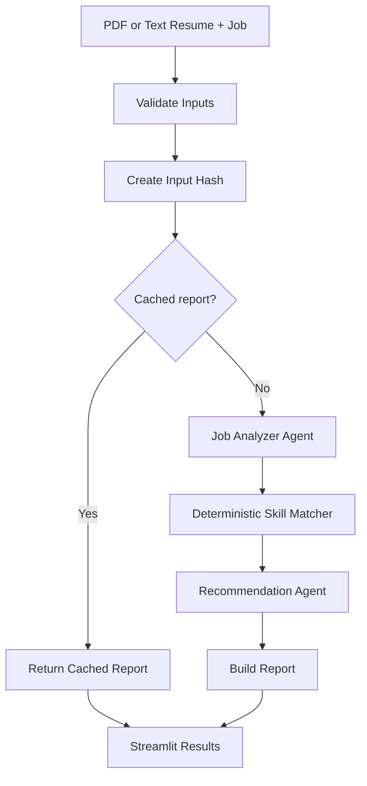

# CareerPilot AI Architecture

CareerPilot separates deterministic résumé matching from LLM-based language understanding.
LangGraph coordinates each stage and decides whether an explicitly enabled cache can be reused.

## Workflow

## Components

- `config.py` — validates input limits and reads API/model configuration.
- `resume_reader.py` — extracts and validates PDF or plain-text résumé content.
- `job_analyzer.py` — uses Gemini structured output to convert a job description into required skills, preferred skills, responsibilities, and ATS keywords.
- `skill_matcher.py` — performs symmetric alias matching, deduplication, and dynamic scoring.
- `prompts.py` — separates application instructions from untrusted user-supplied text.
- `recommendation_agent.py` — generates grounded strengths, gaps, résumé improvements, learning steps, interview questions, and a next action.
- `cache.py` — provides an opt-in local cache keyed by a SHA-256 input hash.
- `graph.py` — defines the LangGraph state, nodes, router, and final workflow.
- `app.py` — provides the Streamlit interface.

## Design choice

The LLM does **not** invent the numeric match score. CareerPilot calculates required and preferred
skill coverage with deterministic Python logic. ATS keyword coverage is reported separately.
Gemini handles tasks that benefit from language understanding.

External AI clients can be injected into the analyzer functions. Tests therefore validate model
request structure and response parsing without making network calls or spending tokens.

## Trust boundaries

Résumé and job-description content is untrusted. Prompts JSON-encode these inputs inside explicit
data tags and direct the model not to follow instructions contained within the payload. Pydantic
validates the structured output before the workflow uses it.

## Privacy

Uploaded résumé and job-description files are written only to temporary files by the UI and deleted
after both successful and failed analyses. Persistent disk caching is disabled by default because a
generated report can contain résumé-derived data. Personal PDFs, environment files, caches, and
generated reports are ignored by Git.
